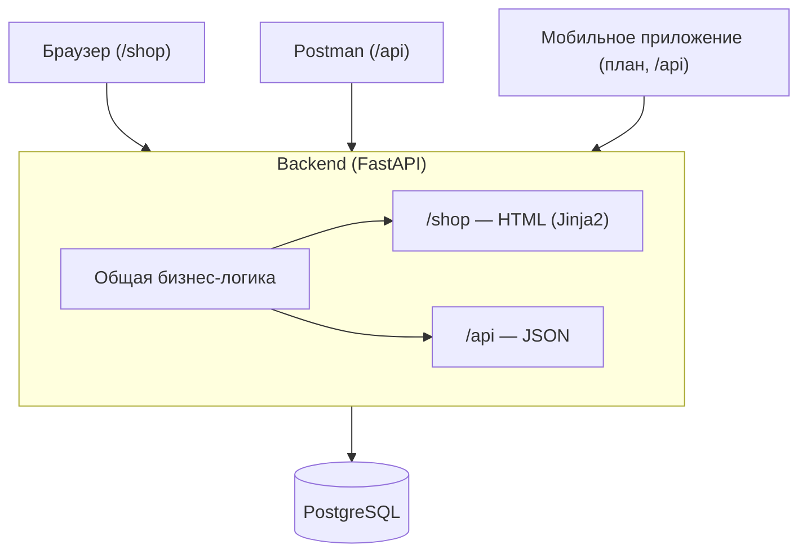

# QA Marketplace — Architecture Decisions

## Стек

| Компонент | Технология | Роль в проекте |
|---|---|---|
| Backend | Python + FastAPI | REST API, автогенерация Swagger-документации |
| База данных | PostgreSQL | Хранение товаров, услуг, пользователей, заказов |
| Веб-интерфейс | Jinja2 + HTML/CSS + HTMX | Серверный рендеринг страниц, без отдельной сборки фронтенда |
| Мобильное приложение | React Native + Expo | Отдельный трек, после стабилизации веб-версии |
| API-документация | Swagger / OpenAPI | Ручное тестирование API через встроенный /docs |
| Manual QA API | Postman | Коллекции запросов, позитивные и негативные сценарии |
| API Automation | Python + Pytest + Requests | Автоматизация проверок REST API |
| Web Automation | Playwright | Автоматизация проверок веб-интерфейса |
| Контейнеризация | Docker Compose | Воспроизводимое окружение (backend + БД) |
| CI/CD | GitHub Actions | Автоматический прогон тестов при пуше в репозиторий |

## Архитектурная схема

## Разделение /shop и /api

Одна бизнес-логика, два представления — не две независимые реализации:

- `GET /api/items/{id}` → JSON, для Postman, автотестов, мобильного приложения
- `GET /shop/items/{id}` → HTML-страница того же товара, для браузера

Оба маршрута вызывают одну и ту же функцию сервисного слоя (например, `get_item(id)`)
и работают с одной базой данных — различается только формат ответа. Это позволяет
проверять согласованность данных между API и UI как отдельный QA-сценарий.

## Аутентификация

Используется единый JWT, выдаваемый при `POST /api/auth/login`.

Передача токена:
- `/api/*` — заголовок `Authorization: Bearer <token>` (для Postman, Pytest, мобильного приложения)
- `/shop/*` — httpOnly, Secure, SameSite=Lax cookie, устанавливается сервером при логине

Backend-зависимость `get_current_user` проверяет оба источника: сначала заголовок,
при его отсутствии — cookie. Так поддерживается единая логика авторизации
для обоих типов клиентов без дублирования кода.

## Модель данных (v1)

Единая сущность `Item` с полем `item_type` (`product` | `service`):
- `product` — обязателен `stock_quantity` (≥ 0), `duration_days` не заполняется.
- `service` — обязателен `duration_days` (> 0), `stock_quantity` не заполняется.

Заказ (`Order`) содержит `fulfillment_method` (`delivery` | `pickup`);
при `delivery` обязательно поле `address`. Статус заказа: см. REQ-ORD-001.

## Ограничения, влияющие на архитектуру

Онлайн-оплата (эквайринг) не входит в v1 — см. `01-product-brief.md`, раздел 7.
Это упрощает архитектуру: не нужен модуль обработки платежей и его тестирование
в первой версии; вместо этого заказ проходит через статус `awaiting_payment`
до ручного подтверждения оплаты.
